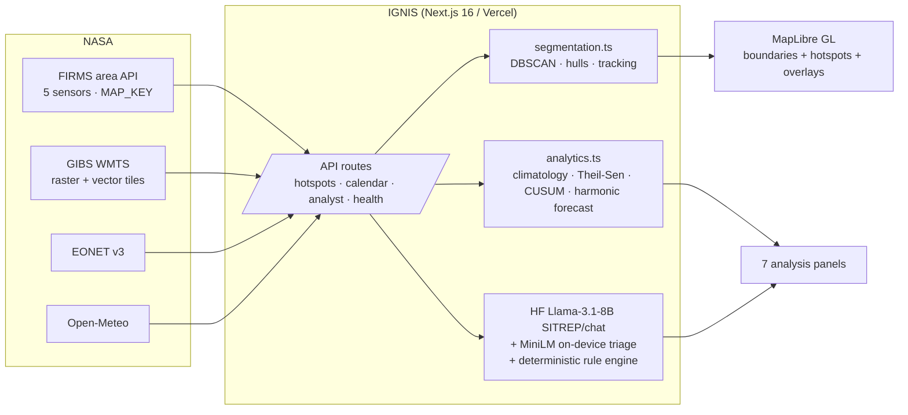

<div align="center">

# 🔥 IGNIS · FIRE CALENDAR

### One 26-year burning-activity record from NASA's split MODIS + VIIRS archive — organized, segmented, and turned into early warning.

**NASA Space Apps Challenge 2026 — Challenge #9: *Harmonization of MODIS and VIIRS Hot Spots***

[](https://nextjs.org) [](https://firms.modaps.eosdis.nasa.gov) [](https://huggingface.co/Nabidnur/ignis-fire-calendar) [](https://www.typescriptlang.org) [](LICENSE)

**Live:** [ignis-spaceapps2026.vercel.app](https://ignis-spaceapps2026.vercel.app) · **Model family:** 4 custom models on [Hugging Face](https://huggingface.co/Nabidnur/ignis-fire-regime-model) · **Dataset:** [Nabidnur/ignis-fire-calendar](https://huggingface.co/datasets/Nabidnur/ignis-fire-calendar)

> 📖 **[Complete Feature Guide →](docs/FEATURES.md)** — every panel, control and analysis method explained: what it is, how to use it, where its data comes from.

> 🔒 *All IGNIS repos (GitHub + Hugging Face) are **private during judging** and will be released publicly after the competition. Credential hygiene: see [docs/SECURITY.md](docs/SECURITY.md).*

</div>

---

## Why IGNIS exists

NASA's two flagship fire instruments are split across two eras and two scales: **MODIS (1 km, Terra 2000 + Aqua 2002)** and **VIIRS (375 m, S-NPP 2012, NOAA-20 2018, NOAA-21 2023)**. A fire small enough for VIIRS to see can be invisible to MODIS — so the *same* landscape produces wildly different detection counts depending on which satellite you ask. That split record breaks any long-term fire-activity analysis: 26 years of MODIS cannot be compared to 14 years of VIIRS without harmonization.

IGNIS answers the challenge statement with a **single, continuous, calibrated Burning Activity Calendar** (2000 → today), then layers everything an early-warning user actually needs on top: **boundary-identified fire clusters**, **persistent-system tracking**, **daily dynamics**, **fire-weather fusion**, and a **grounded AI analyst** that writes incident-style situation reports.

## What makes IGNIS different

| | Typical approach | IGNIS |
|---|---|---|
| Record | Live points only, one sensor era | **26-year harmonized calendar** (9 regions + Bangladesh, precomputed from GIBS archive) |
| Map output | Point cloud | **DBSCAN segmentation → convex-hull fire boundaries**, classified MEGAFIRE / ESTABLISHED / EMERGING / SCATTERED |
| Time | Snapshot | **7-day replay with persistent fire-system tracking** (nearest-centroid, FRP trend) |
| AI | One chat box | **Grounded SITREP generator + cluster explanations**, zero-hallucination guard, deterministic rule-engine fallback, MiniLM on-device triage |
| Honesty | Hidden fallbacks | Every panel shows its **data source, pipeline note and uncertainty** (continuity ratio CV, R², GIBS vector lag) |
| Fallback | None — API down = app down | **Dual-path**: FIRMS area API primary → GIBS WMTS vector-tile parser fallback (works even where FIRMS is blocked) |

## The complete workspace

**The map** is the hero: BLAZE canvas engine (every one of up to 30k detections hoverable +
clickable via a uniform spatial index, proper-red FRP ramp, white-hot cores ≥ 150 MW, ember
underglow, pulses & spread rings, heatmap + hexbin modes), 4 color styles (intensity / sensor
/ confidence / heatmap), NASA GIBS basemaps (true color, 7-2-1 false color, Blue Marble) with
MOD11 LST + GIBS fire-pixel cross-check overlays, nullschool wind streamlines + RainViewer
radar, 24H/48H/7D replay with persistent fire-system tracking, 🔮 next-day risk field,
**🧊 Fire Field / ⛰ Terrain-tower 3D modes**, ⛶ fullscreen focus, and a probed WebGL2 →
Leaflet fallback so blocked GPUs get the full app instead of a crash. **Click any dot → AI
event card** (threat badge, fire type, 6-h spread forecast, smoke & air, CO₂e, one-tap Analyst handoff).

**The rail** is the early-warning column: deterministic rule-engine alerts, EONET events
ranked by on-device MiniLM, GDACS authority alerts, ReliefWeb reports, the 7-day fire-weather
verdict, and per-sensor harmonization telemetry (expert mode). **TopBrief** compresses the
same telemetry into one summary line with a GREEN→AMBER→ORANGE→RED early-alert banner.
**RangeSearch** covers the brief's date-range flow with detections CSV, daily-counts CSV and
GeoJSON exports for any AOI — curated, searched, or hand-drawn.

**The eleven tabs** (every one recomputed for the current AOI, every one names its source):

| Tab | What it gives you |
|---|---|
| 🔥 **Burning Calendar** | 26-yr × 12-mo heatmap per sensor, colorblind-safe ramps (Inferno/viridis/Mono), unusual-month \|z\|≥2 rings, FRP bars, **current-month vs historical-median KPI**, continuity coefficient + CV, click-a-month → map |
| 🎯 **Impact** | ΣFRP → FRE → dry matter → **CO₂e** chain + equivalences; Open-Meteo CAMS US AQI, PM2.5, CO, aerosol depth, smoke suspicion |
| 🔔 **Watchlist** | Personal fire alerts: saved places + radius, 5-min recheck, in-app / browser / e-mail channels, zero server state |
| 🧪 **Fire Cluster Lab** | In-browser DBSCAN + convex-hull boundaries, front-ratio, ΣFRP/spread/hull area, FRP histogram, diurnal signature, persistent-system tracking |
| 📊 **Daily Dynamics** | Stacked per-sensor daily detections, fire energy curve, **MODIS↔VIIRS cross-validation scatter vs the 1:1 line**, deterministic ESCALATING/DECLINING/STEADY verdict |
| 📈 **Time-Series Lab** | Trend/seasonal/residual decomposition, Theil-Sen robust trend, CUSUM change points, p10–p90 climatology envelope, anomaly rings |
| 🧮 **Statistics Science Lab** | 7 expert sub-tabs: Mann-Kendall + Sen · ACF + Hurst · DFT periodogram · **Gumbel EVT return periods** + POT register · **Bland-Altman sensor agreement** · phenology Gantt · FRP economics (Gini) + **Moran's I + LISA** — 28/28 synthetic-test verified, each with a plain-language read |
| 🔭 **Seasonal Outlook** | Harmonic-regression 12-month forecast with uncertainty band + event-detector **P(extreme month)** badge |
| 🧭 **Burn Regime** | Nearest-prototype classification vs 8 NASA-derived reference regimes (regime model, 138k detections) |
| 📜 **Methodology** | Full provenance + harmonization math + MOD11 decode + S-NPP sunset note — every limitation in the open |
| 🤗 **Open Science** | Live Hugging Face hub view: model family + 26-yr dataset with datasets-server preview |

A 6-step **guided tour** (◈ header button) walks first-time visitors through all of it.
Full details in the [Complete Feature Guide](docs/FEATURES.md).

## Architecture



**API-first by design.** No runtime chat-LLM dependency anywhere in the critical path: segmentation, analytics, classification and the early-warning rule engine are deterministic TypeScript running in-browser. Hugging Face models power the *conversational* layer (grounded Llama-3.1-8B with a zero-hallucination guard and a full deterministic fallback that produces the same SITREP structure offline) and event triage (all-MiniLM-L6-v2 via transformers.js/ONNX). Every feature degrades gracefully — the app is fully usable with all AI endpoints down.

## Science & method

- **Harmonization:** seasonal overlap-window continuity coefficient — for each calendar month *m*, *r(m)* = median log-ratio VIIRS-SNPP / MODIS-Terra over the 2012+ overlap, shrunk toward the all-months median *r̄* when a month has few overlap years; pre-2012 estimates are `MODIS(y,m) × r(m)`. After the S-NPP archive ends, NOAA-20 / NOAA-21 are bridged onto the S-NPP scale with their own overlap ratios, so the record continues on the VIIRS constellation. The ratio's CV is surfaced as an uncertainty readout; every unified month carries its source sensor (`src`) and MODIS-era rows are marked `scaled: true`. Details: [docs/DATA_PIPELINE.md](docs/DATA_PIPELINE.md#1b-harmonization-buildunified-in-srclibignisanalyticsts).
- **Segmentation:** grid-accelerated DBSCAN (ε = clamp(span/45°, 0.14°, 0.9°), minPts = 3 — standard density-clustering practice in burned-area literature); hulls via Andrew's monotone chain; front ratio = perimeter ÷ (2√(πA)).
- **MOD11 LST handling (LP DAAC V6):** LST (K) = stored × 0.02 · emissivity = stored × 0.02 + 0.49 · fill = 0 (black) · QA bit-packed, decoded right→left (LDOPE convention). Palettes follow the official convention: hot = red/orange, cold = green/blue.
- **Data provenance:** every panel names its source — FIRMS NRT (C6.1 / V2), GIBS MVT archive (to Nov 2000), GIBS imagery layer + date, EONET, Open-Meteo — and the status rail verifies all 7 systems live.

## Run locally

```bash
git clone https://github.com/Hisernberg/ignis-spaceapps2026.git
cd ignis-spaceapps2026
npm install
npm run dev          # http://localhost:3000
```

Keys are read from env (`FIRMS_MAP_KEY`, `NASA_API_KEY`, `HF_TOKEN`) — see `secrets/.env.example`. Get a free FIRMS MAP_KEY at [firms.modaps.eosdis.nasa.gov/api/area](https://firms.modaps.eosdis.nasa.gov/api/area/). The GIBS fallback needs no key at all, so the app runs out-of-the-box.

Rebuild the precomputed record yourself:

```bash
node scripts/ignis/build_calendar.mjs             # 26-year calendars from GIBS archive (5 sensors, 2 days/month)
node scripts/ignis/build_calendar.mjs --full      # every day → exact monthly counts (slow)
node scripts/ignis/build_regimes.mjs              # regime prototypes from the calendars
```

`build_calendar.mjs` needs Node ≥ 22.18 (it imports the shared `src/lib/ignis/calendarBuilder.ts` directly); see [docs/DATA_PIPELINE.md](docs/DATA_PIPELINE.md) for all flags.

## Deployment (Vercel)

**This is the deployment repo.** Every push to `main` auto-builds and ships to production at [ignis-spaceapps2026.vercel.app](https://ignis-spaceapps2026.vercel.app) — the Vercel project `ignis-spaceapps2026` is connected to **this repository only**.

> ⚠️ Do **not** connect a Vercel project to [ignis-public](https://github.com/Hisernberg/ignis-public) — that is the community showcase mirror: same app code, zero credentials. A deployment created from it serves keyless demo mode unless you add your own free keys (see its README "Deploy to Vercel"). The official production keys live only in this repo's Vercel environment.

Production checklist: Next.js 16 · Turbopack build · Node 20.x · routes `/api/{hotspots,calendar,outlook,eonet,gibsfires,geocode,hf,health,ping}` all dynamic (`ƒ`) · brand metadata (`metadataBase`, OG/Twitter card, favicon set) served from `public/`.

## API reference

| Route | Purpose |
|---|---|
| `GET /api/hotspots?w&s&e&n&day&days` | Per-sensor detections (FIRMS primary, GIBS MVT fallback) for 1–10 day windows, ML-classified per detection |
| `GET /api/hotspot?…` | Single-detection AI event-card payload (threat badge, type, spread, CO₂e) |
| `GET /api/gibsfires?w&s&e&n&day` | GIBS WMTS **vector** fire pixels → GeoJSON (independent FIRMS cross-check) |
| `GET /api/calendar?region` | Precomputed 26-year harmonized monthly calendar + harmonization meta |
| `GET /api/calendar?w&s&e&n&name` | **On-demand calendar for any custom AOI** (≤ 4 archive tiles ≈ 9°×9°), built from the GIBS archive with the same builder, cached |
| `GET /api/outlook?region` | 12-month harmonic-regression forecast with uncertainty band |
| `GET /api/search?bbox&from&to` | **Date-range search** (≤45-day span, 10-day chunks): per-day/per-sensor analytics + CSV & GeoJSON download contracts |
| `GET /api/impact` | ΣFRP → FRE → dry matter → CO₂e chain + 26-yr record context for the AOI |
| `GET /api/air-quality` | Open-Meteo CAMS air quality (US AQI, PM2.5, CO, AOD) for the AOI center |
| `GET /api/eonet?region` | EONET events ranked by MiniLM semantic + geo relevance |
| `GET /api/gdacs` | GDACS wildfire alerts (EC/JRC RSS): alert level, geo, ISO3, severity (ha) |
| `GET /api/reliefweb?region` | ReliefWeb (UN OCHA) disaster reports — wildfire-first with honest context labeling |
| `GET /api/context?q` | Wikipedia region context (placard for the current AOI) |
| `POST /api/analyst` | `{question, context, mode: "chat" \| "sitrep"}` → grounded Llama-3.1-8B answer, rule-engine fallback |
| `GET /api/geocode?q` | Place search (OSM Nominatim proxy) |
| `GET /api/health` | Live status of FIRMS, api.nasa.gov, GIBS, EONET, HF, Open-Meteo, Earthdata JWT |
| `GET /api/hooks/digest` | Machine-readable daily fire digest for **n8n** / GitHub Actions / Vercel Cron (optional `IGNIS_HOOK_TOKEN` bearer guard) — importable workflow at `automation/ignis-n8n-workflow.json`, cron wired in `vercel.json` |

## Repository map

```
src/
  app/page.tsx                  # mission control — KPI strip, map, 7 tabs, AI drawer
  components/ignis/             # MapPanel, SegmentationPanel, DynamicsPanel, CalendarPanel, …
  lib/ignis/
    segmentation.ts             # DBSCAN + convex hulls + persistence tracking (deterministic)
    analytics.ts                # climatology, Theil-Sen, CUSUM, harmonic forecast, regimes
    firms.ts                    # 5-sensor FIRMS client + GIBS MVT fallback
    regions.ts                  # region registry, GIBS layer catalog, MOD11 constants
  app/api/                      # hotspots · gibsfires · calendar · outlook · analyst · gdacs · reliefweb · context · hooks/digest · …
data/ignis/                     # precomputed 26-yr calendars + outlooks (9 regions)
scripts/ignis/                  # build_calendar.mjs, build_regimes.mjs (reproducible pipeline)
automation/                     # importable n8n wildfire-digest workflow
docs/                           # ARCHITECTURE · DATA_PIPELINE · UI_UX_SYSTEM · SUBMISSION · JUDGE_SCORECARD
```

## The IGNIS model family (trained on real NASA FIRMS data)

| Model | Task | Headline result (honest holdout) | In-app wiring |
|---|---|---|---|
| [`ignis-fire-regime-model`](https://huggingface.co/Nabidnur/ignis-fire-regime-model) | DBSCAN complex segmentation + K-means regime classifier | 63 complexes · silhouette 0.178 · 4 megafires | ⚡ Burn Regime panel (on-device prototypes) |
| [`ignis-fire-classifier`](https://huggingface.co/Nabidnur/ignis-fire-classifier) | Per-detection behavior classification (weak supervision from the segmentation engine) | HGB ref 0.763 · **extra-trees portable twin 0.685** held-out agreement | ⚡ EVERY detection scored live in `/api/hotspots` + cluster ML votes |
| [`ignis-event-detector`](https://huggingface.co/Nabidnur/ignis-event-detector) | Next-month extreme-fire-month early warning (25-yr calendars) | AUC 0.740 · PR-AUC 0.606 on 2022-26 holdout | ⚡ Seasonal Outlook P(extreme) badge |
| [`ignis-fire-footprint-forecaster`](https://huggingface.co/Nabidnur/ignis-fire-footprint-forecaster) | Segmentation-based next-day complex-footprint probability field (v2 scene-normalized) | LR twin IoU 0.58/0.55/0.42 vs persistence 0.36/0.39/0.38 · HGB 0.65/0.50/0.60 | ⚡ map 🔮 next-day risk-field overlay + Daily Dynamics card |

Every repo ships the exact training script, data snapshot, metrics (including baselines and limitations) and a full model card — the same open-science standard as NASA+IBM's Prithvi releases. Mirrored as private GitHub repos: `ignis-model-*` + `ignis-data`. **All four models are wired live into the product** — nothing on the Hub is decorative.

## Earthdata Login (EDL) integration

A long-lived EDL bearer JWT (`nabid12`, expires 2026-11-20) authenticates CMR queries
(`Authorization: Bearer …`) — the entitlement path for LP DAAC MOD11 LST granules and
ASF reruns. `/api/health` validates it live against CMR on every check and the status
rail shows the remaining days, so token expiry is visible before it ever breaks a
demo. Plaintext lives only in the private vault; the app fallback is base64-encoded.

## Project links

- 🌐 **Live app:** <https://ignis-spaceapps2026.vercel.app>
- 🤗 **Hugging Face (model family + dataset + vault):** <https://huggingface.co/Nabidnur/ignis-fire-regime-model>
- 🎬 **Demo video:** see `docs/SUBMISSION.md` for the 3-minute walkthrough script
- 📚 **Docs:** [Complete Feature Guide](docs/FEATURES.md) · [Architecture](docs/ARCHITECTURE.md) · [Data pipeline](docs/DATA_PIPELINE.md) · [API greenlight report](docs/APIS.md) · [Security](docs/SECURITY.md) · [Submission checklist](docs/SUBMISSION.md) · [Judge scorecard](docs/JUDGE_SCORECARD.md) · [Contributing](CONTRIBUTING.md)

## Team IGNIS

Built from **Bangladesh 🇧🇩** for the NASA International Space Apps Challenge 2026 — where crop-residue fire smoke is a leading driver of Dhaka's winter air-quality crisis, and why the harmonized fire record matters at home, not just in the boreal zone.

## License

MIT — see [LICENSE](LICENSE). NASA data is free and open (FIRMS/LANCE, GIBS, EONET, LP DAAC). Not endorsed by NASA.
